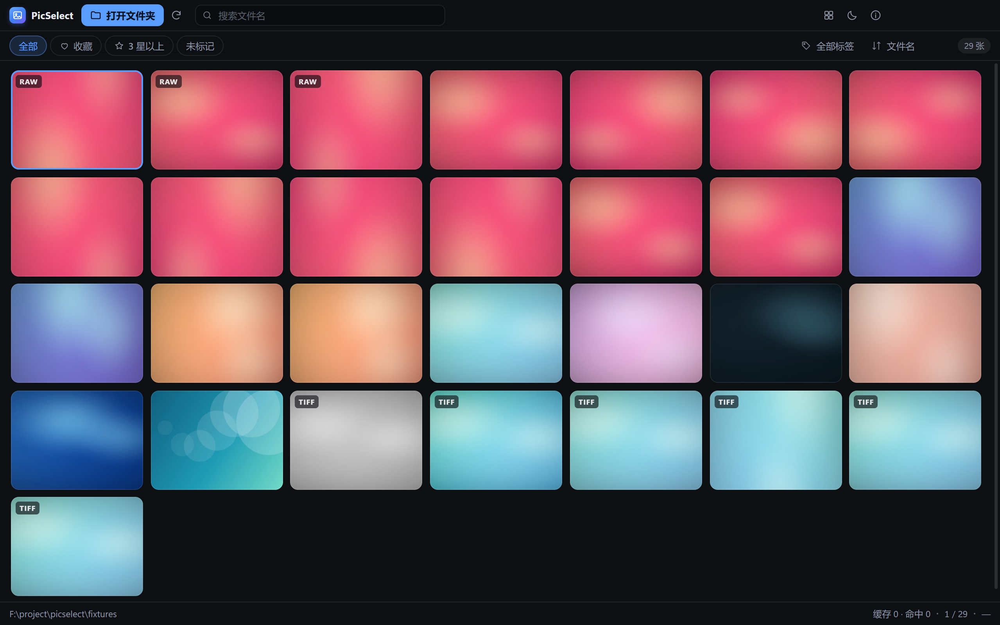
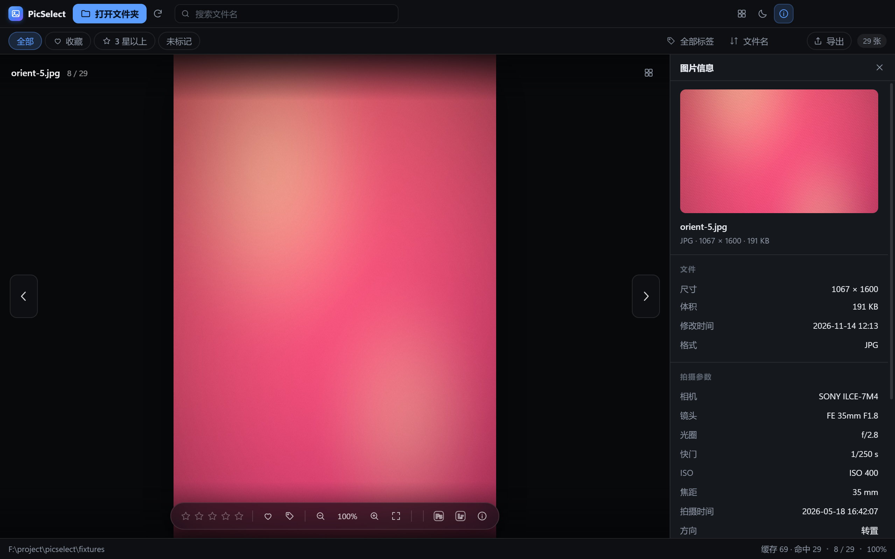

# PicSelect

轻量、快速的本地照片查看与标记工具。单目录浏览 + 缩略图预加载 + 星级/收藏/标签，支持 JPEG / PNG / GIF / WebP / BMP / AVIF / SVG / TIFF，以及索尼 ARW、佳能 CR2/CR3、尼康 NEF 等 20 余种 RAW 格式。

- 零 npm 运行时依赖：只依赖 Electron 自身，无打包构建、无前端框架，改代码即时生效。
- 界面为原生 ES Module + CSS，深/浅色双主题，窗口宽度 720px 至全屏自适应。



<p align="center"></p>

## 快速开始

```bash
npm install     # 只装 electron 一个包
npm start
```

Windows 上也可以直接双击 `start.bat`（会自动检查依赖，缺失时执行 `npm install`）。

启动后点左上角「打开文件夹」，或直接把文件夹/图片拖进窗口。程序会记住上次打开的目录，下次启动自动恢复。

命令行参数：

```bash
npx electron . --open "D:\Photos"      # 启动即打开指定目录
npx electron . --select 3             # 打开后定位到第 3 张（配合 --open）
npx electron . --theme light          # 强制浅色
```

## 打包成 Windows 程序

```bash
npm run pack    # 只出免安装目录 dist/win-unpacked（约 10 秒，用来快速验证）
npm run dist    # 出安装包 + 便携版（首次约 2 分钟，需下载 NSIS 等打包工具）
```

产物在 `dist/`：

| 文件 | 体积 | 说明 |
| --- | --- | --- |
| `PicSelect-1.0.0-setup.exe` | 116 MB | NSIS 安装包，可选安装目录，建桌面/开始菜单快捷方式 |
| `PicSelect-1.0.0-portable.exe` | 106 MB | 单文件便携版，双击即用，不写注册表 |
| `win-unpacked/` | 358 MB | 免安装目录，可直接运行 `PicSelect.exe` |

几点说明：

- **体积**基本就是 Electron 运行时（约 355 MB 解压后），应用自身的代码只有 268 KB。
- **便携版是绿色版**：数据写在 exe 同级的 `PicSelectData/`，整个文件夹拷到 U 盘换台机器打开，标记和偏好都还在。放在只读目录时会自动退回 `%APPDATA%\PicSelect`。
- **没有 asar 打包**：`app://` 协议是把真实文件路径交给 `net.fetch` 处理，保持散文件可以让打包版和开发时行为完全一致，避免 asar 虚拟路径取不到图片。
- **未做代码签名**：首次运行 Windows SmartScreen 会提示「未知发布者」，点「更多信息 → 仍要运行」即可。要消除提示需自备签名证书。
- 打包脚本内置 npmmirror 镜像（`scripts/dist.js`），国内网络不会卡在 GitHub 下载。

## 功能结构

```
┌──────────────────────────────────────────────┐
│ 标题栏  打开文件夹 / 重扫 / 搜索  缩略图大小 主题 信息 │
├──────────────────────────────────────────────┤
│ 筛选条  全部 · 收藏 · 3星以上 · 未标记  |  标签 排序 计数 │
├───────────────────────────┬──────────────────┤
│                           │                  │
│   网格视图 / 大图查看器      │   图片信息面板     │
│                           │   EXIF + 标记     │
├───────────────────────────┴──────────────────┤
│ 状态栏  当前目录 · 缓存条数 · 位置 · 缩放比例        │
└──────────────────────────────────────────────┘
```

- **网格视图**：虚拟化渲染，无论目录里有 10 张还是 1 万张，DOM 里始终只有可视区附近的瓦片。每张瓦片带角标（格式/RAW）、收藏心形和可点击的星级。
- **大图查看器**：A/B 双层 `` 交叉淡入，切图无白闪；支持滚轮以光标为锚点缩放、拖拽平移、双击在「适应窗口 / 100%」间切换。
- **信息面板**：文件名、尺寸、体积、修改时间、格式、预览来源，以及相机/镜头/光圈/快门/ISO/焦距/拍摄时间/方向。
- **标记**：0–5 星评分、收藏、任意标签（去重，单张最多 24 个）。网格、查看器、信息面板三处操作实时同步。

## 格式支持

| 类别 | 扩展名 | 处理方式 |
| --- | --- | --- |
| 常见位图 | `.jpg .jpeg .jpe .jfif .png .apng .gif .webp .bmp .avif .ico` | Chromium 原生解码，`img-src` 直出 |
| 矢量 | `.svg` | 原生渲染，缩略图另存为栅格缓存 |
| TIFF | `.tif .tiff` | 主进程纯 JS 解码（无压缩 / LZW / Deflate / PackBits，含 predictor、16bit、CMYK、调色板），转 PNG |
| RAW | `.arw .srf .sr2 .cr2 .cr3 .crw .nef .nrw .dng .orf .rw2 .raf .pef .srw .raw .rwl .x3f .3fr .erf .mrw` | 提取文件内嵌 JPEG 预览，不做去马赛克解码 |

RAW 的处理策略是「找现成的图」而不是算出来：

1. 解析 TIFF/IFD 结构，从 SubIFD、ExifIFD、IFD0、IFD1 定向抽取预览条目；
2. 失败则全文件扫描 JPEG 标记（`FFD8 ... FFD9`），用「体积/像素比」合理性检验剔除 256×256 之类的缩略图假阳性；
3. 仍失败则退回系统缩略图接口。

缩略图请求（`?w=440`）会挑选 ≤2048 宽的预览，避免为了一个 168px 瓦片去解码 24MP 全图；大图请求才用全分辨率预览。提取结果按 SHA-1 缓存到磁盘，二次打开为毫秒级。

## 快捷键

| 键 | 作用 |
| --- | --- |
| `Ctrl + O` | 打开文件夹 |
| `F5` | 重新扫描当前目录 |
| `/` | 聚焦搜索框 |
| `←` `→` / `J` `K` | 上一张 / 下一张 |
| `空格` / `Shift + 空格` | 下一张 / 上一张 |
| `Home` `End` | 第一张 / 最后一张 |
| `0`–`5` | 打 0–5 星 |
| `F` | 收藏 / 取消收藏 |
| `T` | 添加标签 |
| `I` | 显示 / 隐藏信息面板 |
| `G` | 网格 ⇄ 大图切换 |
| `+` `-` `Ctrl + 0` | 放大 / 缩小 / 适应窗口 |
| 双击图片 | 适应窗口 ⇄ 100% |
| `Esc` | 关闭查看器 / 取消输入 |

## 数据存储

| 内容 | 位置 |
| --- | --- |
| 标记与偏好 | `%APPDATA%\PicSelect\library.json` |
| RAW 预览缓存 | `%APPDATA%\PicSelect\cache\raw\<sha1>.jpg`（上限 500MB，自动清理最旧） |
| 缩略图缓存 | IndexedDB（渲染进程，库名 `picselect`） |

便携版（`PicSelect-*-portable.exe`）把上面三项整体放在 exe 同级的 `PicSelectData\` 下，不再写入 `%APPDATA%`。

`library.json` 采用原子写入（临时文件 + rename，失败指数退避重试）加上 220ms 防抖，程序退出前会强制 `flush()`，不会出现半截文件。删除这个文件即可重置所有标记，照片本身永不被修改。

```json
{
  "version": 1,
  "photos": {
    "d:\\photos\\dsc01835.arw": { "rating": 4, "favorite": true, "tags": ["人像", "待修"] }
  },
  "prefs": { "lastDir": "D:\\Photos", "theme": "system", "thumbSize": 168, "sort": "name" }
}
```

## 目录结构

```
src/main/            主进程
  main.js            启动、命令行参数、单实例
  window.js          无边框窗口 + 标题栏叠加
  protocol.js        app:// 协议（页面、样式、图片、RAW/TIFF 转码）
  ipc.js             全部 IPC 通道
  library.js         目录扫描（非递归，中文本地化自然排序）
  store.js           library.json 原子持久化
  exif/              TIFF/IFD 解析、EXIF 提取、方向处理、尺寸嗅探
  tiff/              纯 JS TIFF 解码器 + PNG 编码器（LZW/PackBits/Deflate）
  raw/               RAW 内嵌预览提取（IFD → 全文件扫描 → 系统兜底）
src/preload/         contextBridge 白名单
src/renderer/        index.html、styles/、js/（state / grid / viewer / infolist / preload）
scripts/             测试素材生成、解析器断言、UI 端到端测试、截图工具
fixtures/            程序生成的测试图片（29 个）
raw/                 放真实 RAW 样片的地方（不纳入版本控制）
```

### 为什么用 `app://` 而不是 `file://`

`file://` 下页面没有正常的 origin，IndexedDB 与 Web Storage 会被禁用，`fetch` 也不可用。所以注册了一个 `standard + secure` 的自定义 scheme：页面和图片同 host（`app://picselect/`），既拿到了存储能力，又避免了跨域与 CORS 问题。

图片路径全部用 base64url 整串编码进 URL，绕开 Windows 反斜杠、中文文件名和 `#?%` 的 URL 解析陷阱。

### 方向为什么不会转两次

Chromium 默认按 EXIF 的 `Orientation` 自动旋转（`image-orientation: from-image`），所以渲染层一律不做旋转。主进程只负责让图片「字节自己说清楚」：RAW 内嵌预览若缺 APP1 就注入一个最小 EXIF 头；TIFF 解码时直接在像素层烘焙旋转并清除方向标记。两层各司其职，图片永远不会被转两遍。

## 测试

```bash
npm run fixtures      # 生成 29 个测试素材（含 8 种方向、6 种 TIFF 编码、3 种 RAW 布局）
npm test              # 解析器断言：33 项，纯 Node 运行
npm run test:ui       # 端到端交互：21 项
npm run shot -- --scene grid --theme dark --out shots/grid.png
```

## 已知限制

- **HEIC/HEIF 不支持**：Chromium 无 HEVC 解码能力，纯 JS 实现不划算，扫描时直接跳过并在状态栏提示。
- **RAW 只看预览**：显示的是相机写入的内嵌 JPEG（通常是全分辨率、已应用机内风格），不是原始传感器数据的解码结果。没有内嵌预览的机型（例如部分 CR3）会退化为系统缩略图。
- **CR3 是 ISO BMFF 容器**：不走 TIFF/IFD 路径，只能靠全文件扫描或系统兜底，成功率取决于文件是否有内嵌 JPEG。
- **大尺寸 TIFF**：分块（Tiled）TIFF 暂不支持，会降级为系统缩略图；超过 64MB 的文件只读取头部提取 EXIF。
- **单目录、非递归**：不做目录树，一次只浏览一个文件夹。需要批量操作请配合系统文件管理器。
